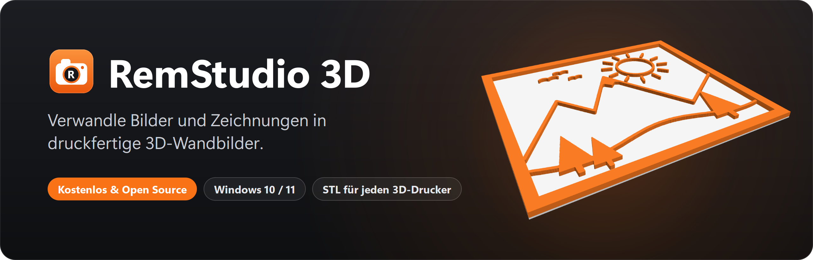
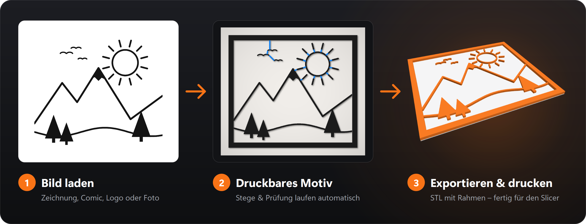
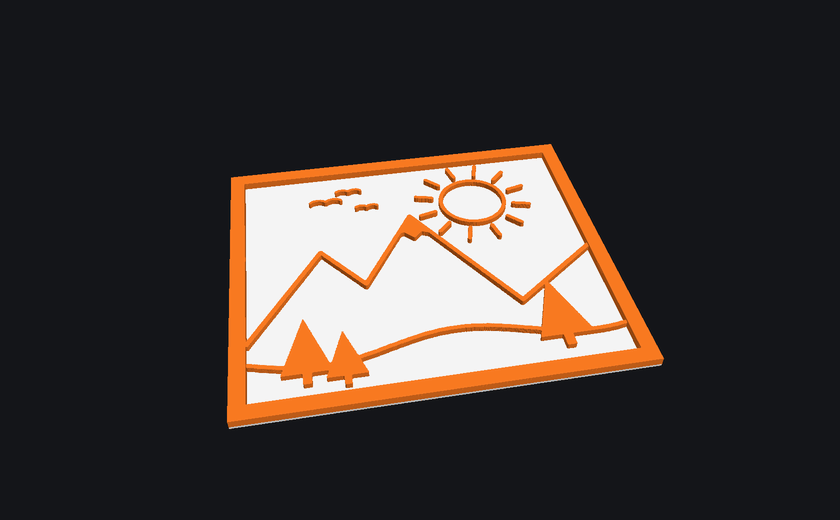
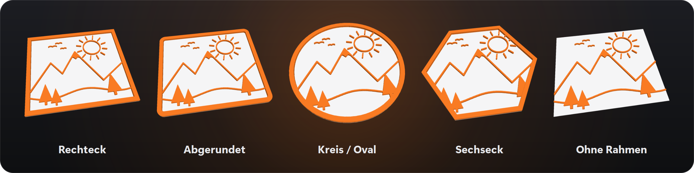
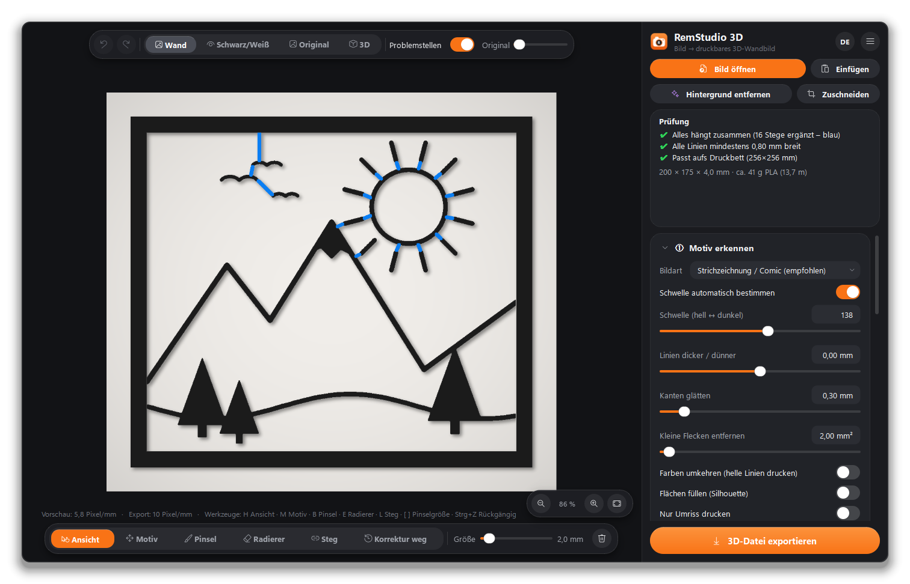
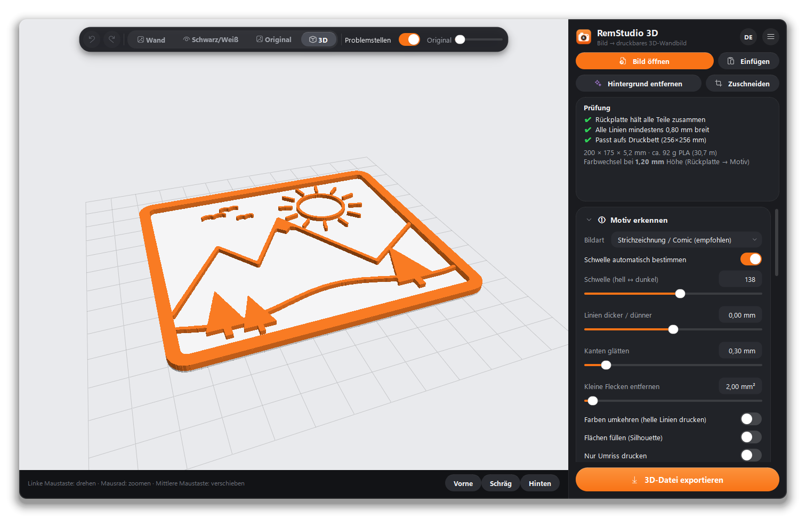
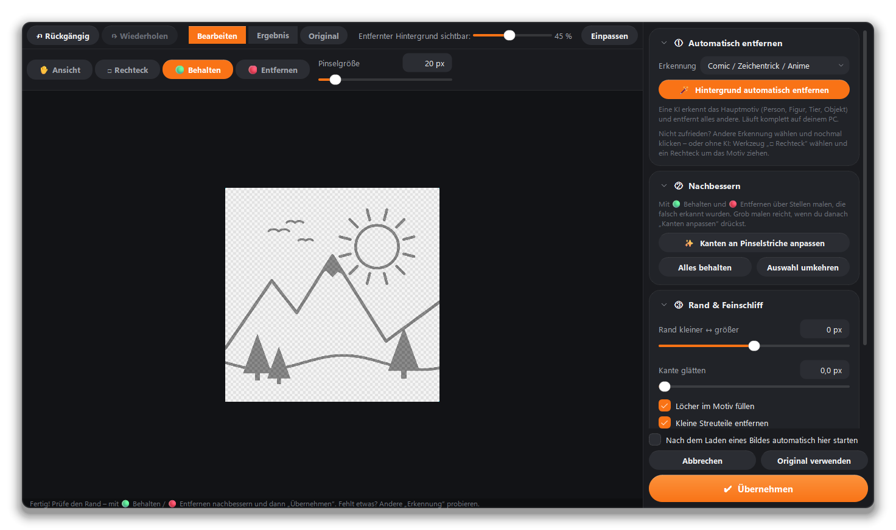
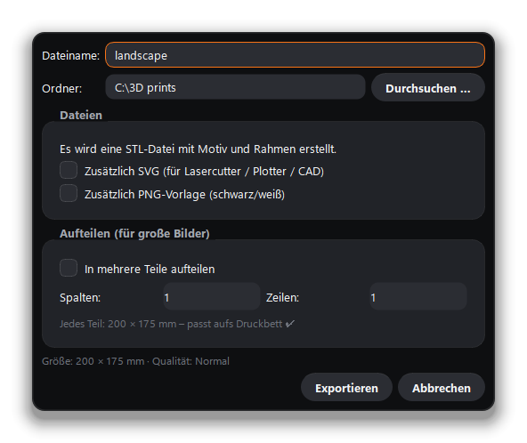

<p align="center">
  
</p>

<p align="center">
  <a href="https://github.com/Remomniac/RemStudio-3D/releases/latest"></a>
</p>

<p align="center">
  <a href="https://github.com/Remomniac/RemStudio-3D/releases/latest"></a>
  <a href="LICENSE"></a>
  
  
</p>

<p align="center">
  <a href="README.md">English</a> · <b>Deutsch</b>
  &nbsp;|&nbsp;
  <a href="#-funktionen">Funktionen</a> ·
  <a href="#-screenshots">Screenshots</a> ·
  <a href="#-download--installation">Download</a> ·
  <a href="#-schnellstart">Schnellstart</a> ·
  <a href="#-selbst-bauen">Selbst bauen</a>
</p>

---

**RemStudio 3D** macht aus einem Bild – einer Zeichnung, einem Comic-Panel, einem Logo oder sogar einem Foto – ein
3D-druckbares Wandbild mit passendem Rahmen. Bild laden, ein paar Regler anpassen, STL exportieren und ab zum
3D-Drucker. Ganz ohne 3D-Kenntnisse: Lose Teile werden automatisch verbunden und jede Linie wird auf Druckbarkeit
geprüft.

<p align="center">
  
</p>

<p align="center">
  
</p>

## ✨ Funktionen

<table>
  <tr>
    <td width="33%" valign="top">
      <br>
      <b>KI-Hintergrund-Entfernung</b><br>
      <sub>Startet direkt nach dem Laden und läuft lokal auf deinem PC. Nachbessern mit den Pinseln „Behalten“ / „Entfernen“ – oder ohne KI per Rechteck-Auswahl.</sub>
    </td>
    <td width="33%" valign="top">
      <br>
      <b>Intelligente Motiv-Erkennung</b><br>
      <sub>Voreinstellungen für Strichzeichnungen, Comics, Logos, Silhouetten und Fotos (Skizze / Kanten), mit präzisen Reglern für Schwelle, Linienstärke und Glättung.</sub>
    </td>
    <td width="33%" valign="top">
      <br>
      <b>Fünf Rahmenformen</b><br>
      <sub>Rechteck, abgerundet, Kreis / Oval, Sechseck oder ohne Rahmen – mit einstellbarer Größe, Rahmenbreite und Eckenradius.</sub>
    </td>
  </tr>
  <tr>
    <td valign="top">
      <br>
      <b>Automatische Stege</b><br>
      <sub>Lose Teile (z. B. die Strahlen einer Sonne) werden mit möglichst kurzen Stegen verbunden – alles druckt in einem Stück.</sub>
    </td>
    <td valign="top">
      <br>
      <b>Druckbarkeits-Prüfung</b><br>
      <sub>Warnt vor zu dünnen Linien und zu engen Lücken, prüft die Druckbettgröße und schätzt den Materialverbrauch (Gramm und Meter Filament).</sub>
    </td>
    <td valign="top">
      <br>
      <b>Nachbessern</b><br>
      <sub>Pinsel, Radierer und Steg-Werkzeug, Motiv verschieben / skalieren / drehen / spiegeln – alles in Echtzeit auf der Grafikkarte, mit Rückgängig und Wiederholen.</sub>
    </td>
  </tr>
  <tr>
    <td valign="top">
      <br>
      <b>Zweifarbig drucken</b><br>
      <sub>Optionale Rückplatte mit genauer Farbwechsel-Höhe, dazu Aufhängelöcher oder eine Aufhängeöse.</sub>
    </td>
    <td valign="top">
      <br>
      <b>Live-3D-Vorschau</b><br>
      <sub>Vor dem Druck drehen, zoomen und prüfen – Ansichten vorne, schräg und hinten mit einem Klick.</sub>
    </td>
    <td valign="top">
      <br>
      <b>Export als STL, SVG & PNG</b><br>
      <sub>STL für jeden Slicer, automatisches Aufteilen großer Teile passend zum Druckbett, SVG für Laser/Plotter und PNG-Vorlagen.</sub>
    </td>
  </tr>
  <tr>
    <td valign="top">
      <br>
      <b>Projekte</b><br>
      <sub>Arbeit speichern und wieder öffnen (<code>.remstudio</code>) – inklusive aller Korrekturen.</sub>
    </td>
    <td valign="top">
      <br>
      <b>Deutsch & Englisch</b><br>
      <sub>Sprache jederzeit über <b>EN / DE</b> umschalten – modernes dunkles Design mit präzisen Reglern (0,01 mm; Umschalt-Taste für Feineinstellung).</sub>
    </td>
    <td valign="top">
      <br>
      <b>Kostenlos & Open Source</b><br>
      <sub>MIT-Lizenz, kein Konto, keine Werbung, keine Telemetrie. Installer oder Portable-ZIP – du entscheidest.</sub>
    </td>
  </tr>
</table>

### Rahmenformen

<p align="center">
  
</p>

## 📸 Screenshots

<table>
  <tr>
    <td width="50%"></td>
    <td width="50%"></td>
  </tr>
  <tr>
    <td align="center"><sub><b>Live-Vorschau</b> – blaue Linien sind die automatisch ergänzten Stege</sub></td>
    <td align="center"><sub><b>3D-Vorschau</b> – hier mit Rückplatte für den Zweifarbdruck</sub></td>
  </tr>
  <tr>
    <td width="50%"></td>
    <td width="50%" align="center"></td>
  </tr>
  <tr>
    <td align="center"><sub><b>Hintergrund entfernen</b> – KI-Erkennung mit Pinseln zum Nachbessern</sub></td>
    <td align="center"><sub><b>Export</b> – STL, optional SVG / PNG und Aufteilen großer Teile</sub></td>
  </tr>
</table>

## 📦 Download & Installation

Die neueste Version gibt es auf der Seite [**Releases**](https://github.com/Remomniac/RemStudio-3D/releases/latest):

| Datei | Wofür |
|---|---|
| `RemStudio3D-Setup.exe` | **Installer** (empfohlen) – installiert RemStudio 3D für den aktuellen Benutzer (ohne Administratorrechte), mit Startmenü- und Desktop-Verknüpfung sowie Deinstallation über die Windows-Einstellungen. |
| `RemStudio3D-<version>-portable.zip` | **Ohne Installation** – entpacken und `RemStudio3D.exe` starten. |

**Voraussetzungen:** Windows 10/11 (64 Bit). Das KI-Modell für die Hintergrund-Entfernung wird beim ersten Gebrauch
einmalig heruntergeladen (ca. 180 MB, erst nach deiner Bestätigung) und funktioniert danach offline.

> [!NOTE]
> **Windows-SmartScreen:** Beim ersten Start kann Windows „Der Computer wurde durch Windows geschützt“ anzeigen,
> weil der Installer (noch) nicht digital signiert ist. Klicke auf **„Weitere Informationen“ → „Trotzdem ausführen“**.
> Der komplette Quellcode ist hier im Repository einsehbar.

## 🚀 Schnellstart

1. **Bild laden** per Drag & Drop, „Bild öffnen“ oder <kbd>Strg</kbd>+<kbd>V</kbd>.
2. **Hintergrund entfernen** (startet automatisch) → „Weiter“ – oder „Hintergrund behalten“.
3. Unter **①** die Bildart wählen und mit den Reglern nachjustieren.
4. Unter **②** Form und Größe des Rahmens festlegen.
5. Den Kasten **Prüfung** beachten – grün heißt druckbereit.
6. **3D-Datei exportieren** → STL im Slicer (Bambu Studio, PrusaSlicer, Cura …) öffnen und drucken.

Ausführliche Hilfe im Programm mit <kbd>F1</kbd>.

## 🛠 Selbst bauen

<details>
<summary><b>Aus dem Quellcode starten / Installer bauen</b></summary>

<br>

**Voraussetzungen:** Python 3.10+; für den Installer zusätzlich [Inno Setup 6.7+](https://jrsoftware.org/isinfo.php).

- **Aus dem Quellcode starten:** `start.bat` doppelklicken – beim ersten Mal wird automatisch eine Python-Umgebung eingerichtet.
- **Bauen:** `build.bat` doppelklicken (RemStudio 3D darf dabei nicht geöffnet sein). Das Skript `build.py`
  1. baut das Programm mit PyInstaller (Zwischendateien im Temp-Ordner),
  2. legt `RemStudio3D.exe` + `RemStudio3D_files` in den Projektordner,
  3. erzeugt mit Inno Setup den Installer `RemStudio3D-Setup.exe`.
- **Tests:** `.venv\Scripts\python.exe tests\smoke_test.py`
- **Bilder für diese Seite:** `.venv\Scripts\python.exe make_screenshots.py` erzeugt alles in `docs/images/` neu.

Die fertigen Dateien sind per `.gitignore` vom Repository ausgeschlossen – sie werden als GitHub-**Release** veröffentlicht.

</details>

<details>
<summary><b>Projektaufbau</b></summary>

```
app.py                 Programmstart, Selbsttest für die EXE
remstudio/
  main_window.py       Hauptfenster, Einstellungen, Prüfung, Export-Dialog
  processing.py        Bildverarbeitung: Motiv → druckbare Maske, Stege, Analyse, Vorschau-Ebenen
  mesh.py              Maske → 3D-Netz (Extrusion), STL-Export
  export.py            Export (STL, Aufteilen, SVG, PNG), Materialschätzung
  bgremove.py          Hintergrund-Entfernung (KI-Modelle via ONNX Runtime, GrabCut)
  bg_editor.py         Editor zum Entfernen des Hintergrunds
  canvas.py            2D-Vorschau (OpenGL) mit Werkzeugen
  viewer3d.py          3D-Vorschau
  widgets.py, theme.py Bedienelemente und dunkles Design
  i18n.py              Sprachen (Englisch/Deutsch)
  samples.py           Beispielbild
tests/smoke_test.py    automatischer Schnelltest
installer/             Inno-Setup-Skript und Installer-Bilder
build.py, build.bat    baut Programm und Installer
make_icon.py           erzeugt icon.ico / icon.png (und mit --installer die Installer-Bilder)
make_screenshots.py    erzeugt die Bilder für diese Seite
RemStudio3D.spec       PyInstaller-Bauanleitung
```

</details>

## 🔒 Datenschutz & Daten auf dem PC

- **Keine Telemetrie, kein Konto, keine Werbung.** Der einzige Internetzugriff ist der einmalige Download des
  KI-Modells – und der erst nach deiner Bestätigung.
- **KI-Modelle** für die Hintergrund-Entfernung stammen aus den Releases des Open-Source-Projekts
  [rembg](https://github.com/danielgatis/rembg) und liegen unter `%LOCALAPPDATA%\RemStudio\models`.
- **Einstellungen** liegen in der Windows-Registry unter `HKEY_CURRENT_USER\Software\RemStudio`.
- Beim Deinstallieren kannst du beides mitlöschen.

## 🧩 Verwendete Bibliotheken

PySide6 (Qt, LGPL-3.0), OpenCV (Apache-2.0), NumPy (BSD), pyqtgraph (MIT), PyOpenGL (BSD),
mapbox_earcut (ISC), ONNX Runtime (MIT); KI-Modelle aus dem rembg-Projekt (bitte deren Lizenzen beachten).

## 📄 Lizenz

RemStudio 3D ist Open Source unter der [MIT-Lizenz](LICENSE) – du darfst den Code frei nutzen, ändern und
weitergeben, solange der Copyright-Hinweis erhalten bleibt. Die mitgelieferten Bibliotheken und die KI-Modelle
unterliegen ihren eigenen Lizenzen (siehe oben).

<p align="center"><sub>Mit ❤️ und viel Filament gemacht · <a href="https://github.com/Remomniac">@Remomniac</a></sub></p>
