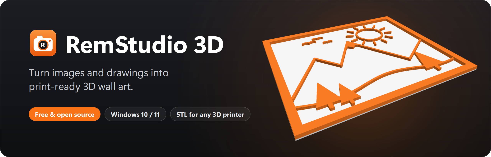
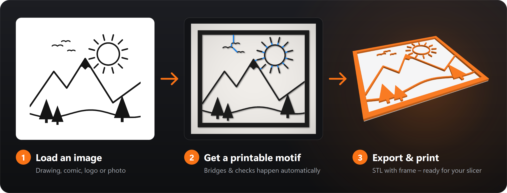
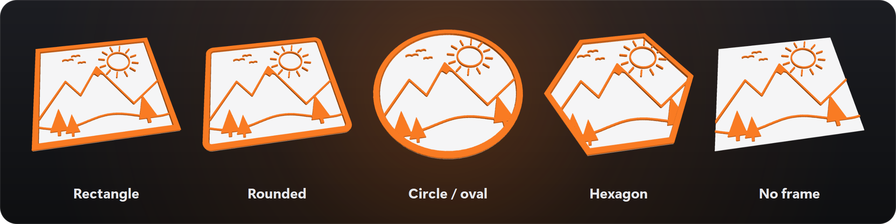
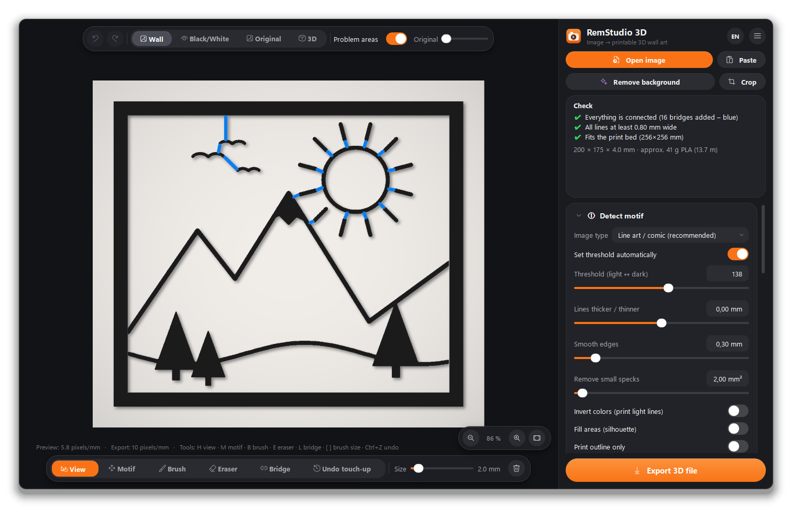
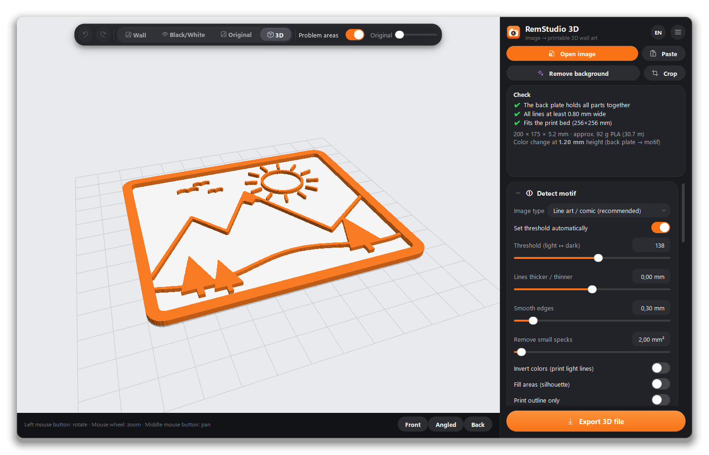
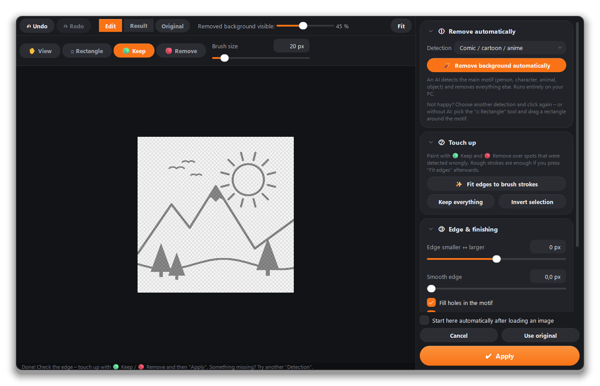
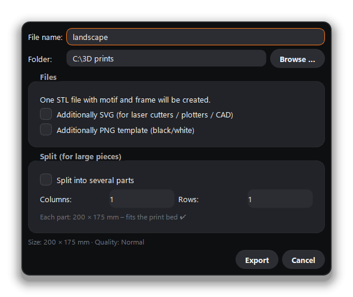

<p align="center">
  
</p>

<p align="center">
  <a href="https://github.com/Remomniac/RemStudio-3D/releases/latest"></a>
</p>

<p align="center">
  <a href="https://github.com/Remomniac/RemStudio-3D/releases/latest"></a>
  <a href="LICENSE"></a>
  
  
</p>

<p align="center">
  <b>English</b> · <a href="README.de.md">Deutsch</a>
  &nbsp;|&nbsp;
  <a href="#-features">Features</a> ·
  <a href="#-screenshots">Screenshots</a> ·
  <a href="#-download--install">Download</a> ·
  <a href="#-quick-start">Quick start</a> ·
  <a href="#-build-it-yourself">Build</a>
</p>

---

**RemStudio 3D** turns a picture – a drawing, a comic panel, a logo or even a photo – into a 3D-printable wall art
piece with a matching frame. Load an image, tweak a few sliders, export an STL and send it to your 3D printer.
No 3D modelling skills required: loose parts are connected automatically and every line is checked for
printability.

https://github.com/user-attachments/assets/638e6862-8196-46f1-b1a4-5eaf2d8c4b78

<p align="center">
  
</p>

<p align="center">
  
</p>

## ✨ Features

<table>
  <tr>
    <td width="33%" valign="top">
      <br>
      <b>AI background removal</b><br>
      <sub>Starts right after loading an image and runs locally on your PC. Touch up with “Keep” / “Remove” brushes – or use a simple rectangle selection without AI.</sub>
    </td>
    <td width="33%" valign="top">
      <br>
      <b>Smart motif detection</b><br>
      <sub>Presets for line art, comics, logos, silhouettes and photos (sketch / edges), with precise sliders for threshold, line thickness and smoothing.</sub>
    </td>
    <td width="33%" valign="top">
      <br>
      <b>Five frame shapes</b><br>
      <sub>Rectangle, rounded, circle / oval, hexagon or no frame – with adjustable size, frame width and corner radius.</sub>
    </td>
  </tr>
  <tr>
    <td valign="top">
      <br>
      <b>Automatic bridges</b><br>
      <sub>Loose parts (like the rays of a sun) are connected with the shortest possible bridges, so everything prints as one piece.</sub>
    </td>
    <td valign="top">
      <br>
      <b>Printability check</b><br>
      <sub>Warns about too-thin lines and too-narrow gaps, checks the print bed size and estimates material (grams and meters of filament).</sub>
    </td>
    <td valign="top">
      <br>
      <b>Touch-up tools</b><br>
      <sub>Brush, eraser and bridge tool, move / scale / rotate / mirror the motif – all in real time on the GPU, with undo and redo.</sub>
    </td>
  </tr>
  <tr>
    <td valign="top">
      <br>
      <b>Two-color printing</b><br>
      <sub>Optional back plate with the exact color-change height, plus hanging holes or a hanging loop.</sub>
    </td>
    <td valign="top">
      <br>
      <b>Live 3D preview</b><br>
      <sub>Rotate, zoom and inspect your piece before printing – front, angled and back views with one click.</sub>
    </td>
    <td valign="top">
      <br>
      <b>STL, SVG & PNG export</b><br>
      <sub>STL for any slicer, automatic splitting of large pieces to fit your print bed, SVG for laser cutters / plotters and PNG templates.</sub>
    </td>
  </tr>
  <tr>
    <td valign="top">
      <br>
      <b>Projects</b><br>
      <sub>Save and reopen your work (<code>.remstudio</code>) including all touch-ups.</sub>
    </td>
    <td valign="top">
      <br>
      <b>English & German</b><br>
      <sub>Switch the language any time via <b>EN / DE</b> – modern dark UI with precise sliders (0.01 mm; hold Shift to fine-tune).</sub>
    </td>
    <td valign="top">
      <br>
      <b>Free & open source</b><br>
      <sub>MIT-licensed, no account, no ads, no telemetry. Installer or portable ZIP – your choice.</sub>
    </td>
  </tr>
</table>

### Frame shapes

<p align="center">
  
</p>

## 📸 Screenshots

<table>
  <tr>
    <td width="50%"></td>
    <td width="50%"></td>
  </tr>
  <tr>
    <td align="center"><sub><b>Live preview</b> – blue lines are the automatically added bridges</sub></td>
    <td align="center"><sub><b>3D preview</b> – here with a back plate for two-color printing</sub></td>
  </tr>
  <tr>
    <td width="50%"></td>
    <td width="50%" align="center"></td>
  </tr>
  <tr>
    <td align="center"><sub><b>Background removal</b> – AI detection with touch-up brushes</sub></td>
    <td align="center"><sub><b>Export</b> – STL, optional SVG / PNG and splitting for large pieces</sub></td>
  </tr>
</table>

## 📦 Download & install

Download the latest version from the [**Releases**](https://github.com/Remomniac/RemStudio-3D/releases/latest) page:

| File | Purpose |
|---|---|
| `RemStudio3D-Setup.exe` | **Installer** (recommended) – installs RemStudio 3D for the current user (no admin rights needed), with Start menu and desktop shortcuts and uninstall via Windows Settings. |
| `RemStudio3D-<version>-portable.zip` | **No installation** – unzip and start `RemStudio3D.exe`. |

**Requirements:** Windows 10/11 (64-bit). The AI model for background removal is downloaded once on first use
(about 180 MB, only after you confirm) and then works offline.

> [!NOTE]
> **Windows SmartScreen:** on first launch Windows may show “Windows protected your PC”, because the installer is not
> digitally signed (yet). Click **“More info” → “Run anyway”**. The complete source code is available in this
> repository.

## 🚀 Quick start

1. **Load an image** via drag & drop, “Open image” or <kbd>Ctrl</kbd>+<kbd>V</kbd>.
2. **Remove the background** (starts automatically) → “Continue” – or “Keep background”.
3. In **①** choose the image type and fine-tune with the sliders.
4. In **②** set the frame shape and size.
5. Keep an eye on the **Check** panel – green means ready to print.
6. **Export 3D file** → open the STL in your slicer (Bambu Studio, PrusaSlicer, Cura …) and print.

Press <kbd>F1</kbd> in the app for the full quick guide.

## 🛠 Build it yourself

<details>
<summary><b>Run from source / build the installer</b></summary>

<br>

**Requirements:** Python 3.10+; for the installer additionally [Inno Setup 6.7+](https://jrsoftware.org/isinfo.php).

- **Run from source:** double-click `start.bat` – on first start it sets up a Python environment automatically.
- **Build:** double-click `build.bat` (RemStudio 3D must not be running). The script `build.py`
  1. builds the app with PyInstaller (intermediate files go to the temp folder),
  2. puts `RemStudio3D.exe` + `RemStudio3D_files` into the project folder,
  3. creates the installer `RemStudio3D-Setup.exe` with Inno Setup.
- **Tests:** `.venv\Scripts\python.exe tests\smoke_test.py`
- **README images:** `.venv\Scripts\python.exe make_screenshots.py` regenerates everything in `docs/images/`.

The build outputs are excluded from the repository via `.gitignore` – they are published as GitHub **releases**.

</details>

<details>
<summary><b>Project structure</b></summary>

```
app.py                 app start, self-test for the built exe
remstudio/
  main_window.py       main window, settings, check panel, export dialog
  processing.py        image processing: motif → printable mask, bridges, analysis, preview layers
  mesh.py              mask → 3D mesh (extrusion), STL export
  export.py            export (STL, splitting, SVG, PNG), material estimate
  bgremove.py          background removal (AI models via ONNX Runtime, GrabCut)
  bg_editor.py         background removal editor
  canvas.py            2D preview (OpenGL) with tools
  viewer3d.py          3D preview
  widgets.py, theme.py controls and dark theme
  i18n.py              languages (English/German)
  samples.py           example image
tests/smoke_test.py    quick automated test
installer/             Inno Setup script and installer images
build.py, build.bat    build app and installer
make_icon.py           creates icon.ico / icon.png (and with --installer the installer images)
make_screenshots.py    creates the images for this README
RemStudio3D.spec       PyInstaller build spec
```

</details>

## 🔒 Privacy & data on your PC

- **No telemetry, no account, no ads.** The only network access is the one-time AI model download – and only after
  you confirm it.
- **AI models** for background removal come from the releases of the open-source project
  [rembg](https://github.com/danielgatis/rembg) and are stored in `%LOCALAPPDATA%\RemStudio\models`.
- **Settings** are stored in the Windows registry under `HKEY_CURRENT_USER\Software\RemStudio`.
- When uninstalling, you can choose to delete both.

## 🧩 Third-party components

PySide6 (Qt, LGPL-3.0), OpenCV (Apache-2.0), NumPy (BSD), pyqtgraph (MIT), PyOpenGL (BSD), mapbox_earcut (ISC),
ONNX Runtime (MIT); AI models from the rembg project (please observe their licenses).

## 📄 License

RemStudio 3D is open source under the [MIT License](LICENSE) – you may freely use, modify and share the code as long
as the copyright notice is kept. The bundled libraries and the AI models are subject to their own licenses (see
above).

<p align="center"><sub>Made with ❤️ and lots of filament · <a href="https://github.com/Remomniac">@Remomniac</a></sub></p>
