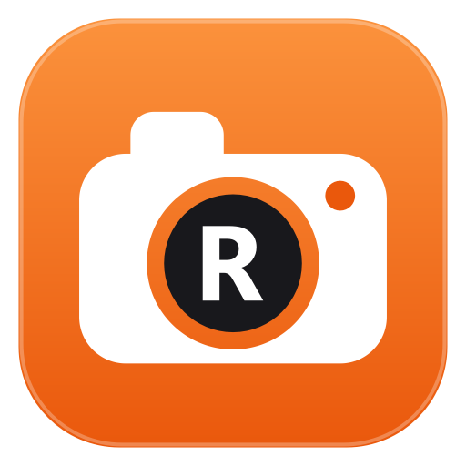

<p align="center">
  
</p>

<h1 align="center">RemStudio 3D</h1>

<p align="center">
  Turn images and drawings into print-ready 3D wall art with a frame – as STL files for your 3D printer.
</p>

<p align="center">
  <a href="README.de.md">Deutsch</a> · <b>English</b>
</p>

<p align="center">
  <a href="https://github.com/Remomniac/RemStudio-3D/releases/latest"></a>
  <a href="LICENSE"></a>
  
</p>

---

## Features

- **Background removal** right after loading an image: automatic AI detection (runs locally on your PC) or a
  rectangle selection without AI; touch up with “Keep” / “Remove” brushes over a semi-transparent preview of the
  original
- **Motif detection** for line art, comics, logos, silhouettes and photos (sketch / edges)
- **Frames:** rectangle, rounded, circle/oval, hexagon or no frame; width, height, frame width, corner radius
- **Motif placement:** move, scale (also beyond the frame), rotate, mirror, crop – in real time on the GPU
- **Printability:** loose parts are connected automatically with the shortest possible bridges; checks for
  too-thin lines and too-narrow gaps
- **Touch-ups:** brush, eraser, bridge tool, undo/redo
- **3D:** motif and frame thickness, back plate for two-color printing (including the color-change height),
  hanging holes or loop, rotatable 3D preview
- **Export:** STL (separate or combined), automatic splitting of large pieces to fit your print bed, plus SVG
  (laser cutter/plotter) and PNG
- **Projects:** save and open (`.remstudio`) including all touch-ups
- Modern dark UI, precise sliders (0.01 mm; hold Shift for fine-tuning)
- English and German

## Download & install

Download the latest version from the [**Releases**](https://github.com/Remomniac/RemStudio-3D/releases/latest) page:

| File | Purpose |
|---|---|
| `RemStudio3D-Setup.exe` | **Installer** (recommended) – installs RemStudio 3D for the current user (no admin rights needed), with Start menu and desktop shortcuts and uninstall via Windows Settings. |
| `RemStudio3D-<version>-portable.zip` | **No installation** – unzip and start `RemStudio3D.exe`. |

**Language:** English (default) or German – switch via **EN/DE** at the top right or in the installer.

**Windows SmartScreen:** on first launch Windows may show “Windows protected your PC”, because the installer is not
digitally signed (yet). Click **“More info” → “Run anyway”**. The complete source code is available in this
repository.

**Requirements:** Windows 10/11 (64-bit). The AI model for background removal is downloaded once on first use
(about 180 MB) and then works offline.

## Quick start

1. Load an image via drag & drop, “Open image” or Ctrl+V.
2. Remove the background (starts automatically) → “Continue” – or “Keep background”.
3. In ① choose the image type and fine-tune with the sliders.
4. In ② set the frame shape and size.
5. Keep an eye on the “Check” panel.
6. “Export 3D file” → open the STL in your slicer (Bambu Studio, PrusaSlicer, Cura …) and print.

Press **F1** in the app for the full quick guide.

## Run from source / build it yourself

**Requirements:** Python 3.10+; for the installer additionally [Inno Setup 6.7+](https://jrsoftware.org/isinfo.php).

- **Run from source:** double-click `start.bat` – on first start it sets up a Python environment automatically.
- **Build:** double-click `build.bat` (RemStudio 3D must not be running). The script `build.py`
  1. builds the app with PyInstaller (intermediate files go to the temp folder),
  2. puts `RemStudio3D.exe` + `RemStudio3D_files` into the project folder,
  3. creates the installer `RemStudio3D-Setup.exe` with Inno Setup.

The build outputs are excluded from the repository via `.gitignore` – publish them as a GitHub **release**.

## Project structure

```
app.py                 app start, self-test for the built exe
remstudio/
  main_window.py       main window, settings, check panel, export dialog
  processing.py        image processing: motif → printable mask, bridges, analysis, preview layers
  mesh.py              mask → 3D mesh (extrusion), STL export
  export.py            export (STL, splitting, SVG, PNG), material estimate
  bgremove.py          background removal (AI models via ONNX Runtime, GrabCut)
  bg_editor.py         background removal editor
  canvas.py            2D preview (OpenGL) with tools
  viewer3d.py          3D preview
  widgets.py, theme.py controls and dark theme
  i18n.py              languages (English/German)
  samples.py           example image
installer/             Inno Setup script and installer images
build.py, build.bat    build app and installer
make_icon.py           creates icon.ico / icon.png (and with --installer the installer images)
RemStudio3D.spec       PyInstaller build spec
```

## Data on your PC

- **AI models** for background removal are downloaded once from the releases of the open-source project
  [rembg](https://github.com/danielgatis/rembg) and stored in `%LOCALAPPDATA%\RemStudio\models`.
- **Settings** are stored in the Windows registry under `HKEY_CURRENT_USER\Software\RemStudio`.
- When uninstalling, you can choose to delete both.

## Third-party components

PySide6 (Qt, LGPL-3.0), OpenCV (Apache-2.0), NumPy (BSD), pyqtgraph (MIT), PyOpenGL (BSD), mapbox_earcut (ISC),
ONNX Runtime (MIT); AI models from the rembg project (please observe their licenses).

## License

RemStudio 3D is open source under the [MIT License](LICENSE) – you may freely use, modify and share the code as long
as the copyright notice is kept. The bundled libraries and the AI models are subject to their own licenses (see
above).
